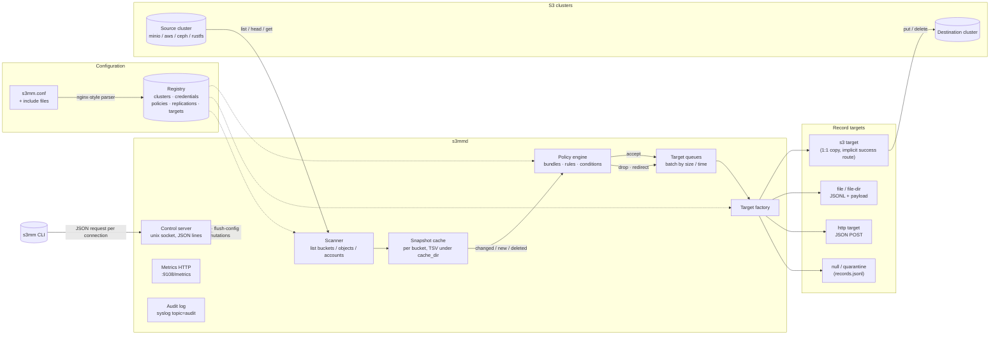

# Architecture

`s3mm` is two binaries and a set of loadable modules:

| Component            | Binary / file             | Role |
|----------------------|---------------------------|------|
| Daemon               | `s3mmd`                   | scans clusters, classifies records, ships them, exposes the control API and metrics |
| CLI client           | `s3mm`                    | talks to the daemon over a unix socket; falls back to offline config edits |
| S3 backend modules   | `modules/*.so`            | vendor glue (MinIO, AWS, Ceph, RustFS) loaded with `dlopen` |
| Configuration        | `s3mm.conf` + includes    | nginx-like syntax, parsed into an in-memory registry |

## High-level data flow



## The daemon

`s3mmd` starts in `Daemon::run()` roughly as follows:

1. **Configuration load** — `config::parse()` reads `s3mm.conf` (nginx-like
   syntax: `#`/`//` comments, quoted strings, `;`-terminated directives,
   `{ }` blocks, `include` with glob wildcards, cycle detection, environment
   variable expansion). Only the top-level `s3mm { … }` block is used; the
   settings directives (`socket`, `pid`, `cache_dir`, `secrets_dir`,
   `module_dir`, `syslog`, `metrics`, `master_key`) and every entity block
   (`cluster`, `credential`, `policy`, `replication`, `target`) live inside
   it — usually pulled in by `include` files.
2. **Registry build** — each entity block is validated and added to a
   `registry::Registry`. Order matters for credentials: a `cluster` resolves
   its `credential` at add time, so credential blocks must precede the
   clusters that reference them.
3. **Module loading** — every `*.so` in the module directory is `dlopen`-ed
   and must export `s3mm_module_entry()` returning an `IModule`. Modules are
   registered by vendor name and used when a cluster's `vendor` matches
   (`minio`, `aws`, `ceph`, `rustfs`); otherwise the native client is used.
4. **Control server** — a unix domain socket (default
   `/run/s3mm/s3mm.sock`, mode 0660). One JSON request per connection, one
   JSON reply, connection closed: `{"ok":true,"data":…}` or
   `{"ok":false,"error":"…"}`.
5. **Replication engines** — one `repl::Engine` per replication, each with a
   scheduler and worker pool driving scan → classify → queue → ship.
6. **Metrics endpoint** — optional HTTP server serving Prometheus text
   format (`s3mm_*` metrics, see below).

### Signals

| Signal       | Effect |
|--------------|--------|
| `SIGTERM`, `SIGINT` | graceful stop: drain workers, flush queues, write cache |
| `SIGHUP`     | reload the configuration file |
| `SIGUSR1`    | force an immediate rescan of all replications |
| `SIGPIPE`    | ignored |

`s3mmd -d` double-forks into the background and writes a pidfile; under
systemd you run it in the foreground and let the supervisor daemonize it.
`s3mmd -t` parses and validates the configuration, then exits with
success/failure — handy for `ExecStartPre=` and CI. `-R/--run-once` performs
a single scan+ship pass over all (or one) replications and exits, for cron.

## Replication pipeline

For each replication (`source`, `destination`, `buckets`, `accounts`,
`policy`, `scan_every`, `queue { … }`, `retention`, `delete_propagation`,
`paused`):

1. **Scan** — the source cluster is listed bucket by bucket (glob-filtered by
   `buckets`), objects are paged with `list_objects` (delimiter-free, so
   "folders" are flattened), and account records are enumerated when the
   policy operates on accounts.
2. **Delta detection** — each bucket keeps a TSV snapshot cache under
   `cache_dir` (`<replication>-<cluster>-<bucket>.tsv`, keys with `/` escaped
   and sorted). Comparing the fresh listing with the snapshot yields three
   streams: *new/changed* objects (size or mtime differ), *deletes* (present
   in cache, absent upstream — only when `delete_propagation` is on), and
   *unchanged* (skipped, no traffic).
3. **Classification** — every record goes through the replication's policy
   bundle: rules are evaluated in order, the first matching rule's actions
   win; otherwise `default_action` applies. Each action outcome also picks a
   route: `accept` → `success`, `drop` → `denied`, `redirect`/`reject`/
   `quarantine`/`alert` → `warning` (plus `log`, which just logs).
4. **Batching** — classified records land in per-replication target queues.
   A queue ships when it exceeds `queue.size`, ages past `queue.time`, or
   the disk budget `queue.max_disk` is hit; objects smaller than
   `queue.min_size` are never transferred.
5. **Shipping** — the target factory resolves each queue's target:
   - `success` route → implicit S3 target writing to the replication's
     destination cluster (bucket created on demand; if the target URI has no
     bucket, the source bucket name is reused 1:1);
   - `denied` route → `null` (logs/stats only) or the configured
     `quarantine` file (`<cache_dir>/quarantine/records.jsonl`);
   - `warning` route → quarantine/audit targets;
   - explicit `target` blocks referenced by `redirect <name>`:
     `null`, `file` (JSONL append, optional payload sidecar or directory
     mode), `http` (JSON POST webhook), `s3` (`s3://cluster/bucket[/prefix]`
     with an optional `template` for the destination key).

   S3 shipping is delta-aware: if the destination object already exists and
   is larger, the copy is skipped; small objects are streamed in memory,
   large ones staged to a temp file and uploaded (multipart when needed).
   Deletes issue `delete_object` after a `head_object` existence check.

6. **Statistics** — per-replication counters (scans, objects, deltas,
   accepted/denied/warning, shipped/failed, bytes, lag) are kept in memory
   and exposed via the control API and `/metrics`.

Account sync (`sync-accounts`) mirrors account/user records from the source
to the destination cluster using the same policy → route pipeline, with a
`--dry-run` mode.

## Policy model

```
policy <name> {
    default_action accept;      # accept | drop | redirect | reject | quarantine | alert | log
    default_route  success;     # success | denied | warning | <target name> | null | quarantine
    rule "..." { ... }
}
```

- A **bundle** is an ordered list of rules plus the two defaults; two built-in
  bundles always exist: `default` (all-accept) and `drop-all` (all-drop).
- A **rule** has an order number, optional name, a condition tree and an
  action list. Conditions support `and`/`or`/`not`/`all`/`any` grouping,
  comparisons (`==`, `!=`, `>=`, `<=`, `>`, `<`), `in` lists, `exists`, and
  `match` glob patterns over typed fields (`source.size`, `source.key`,
  `source.bucket`, `destination.*`, `account.*`, custom metadata keys …).
  Sizes accept unit suffixes (`1M`, `512K`, `2G`).
- **Actions**: `accept`, `drop`, `redirect <target>`, `reject`, `quarantine`,
  `alert`, `log`. The record's *outcome* (success/denied/warning) determines
  which route the queue uses; `redirect` names an explicit target instead.
- Rule evaluation is exercised offline with
  `s3mm rules test --bundle <name> …`.

## Secrets

Secret keys may be stored in the config either as plain quoted strings or as
sealed PEM blocks:

```
-----BEGIN S3MM SECRET-----
<base64 of AES-256-GCM ciphertext>
-----END S3MM SECRET-----
```

The data key is derived from `settings.master_key` with
PBKDF2-HMAC-SHA256 (100 000 iterations, random salt); the payload is
AES-256-GCM. Sealed credentials require `master_key` in `s3mm.conf` and are
opened at registry-load time. CLI secret handling uses the same format.

## Control protocol and CLI

The control API is deliberately trivial: connect to the unix socket, write
one JSON object plus `\n`, read one JSON reply, close. Requests carry a
`command` (and optionally `replication`, `buckets`, `keys`, `format`, …);
responses are `{"ok":true,"data":…}` or `{"ok":false,"error":"…"}`.

The `s3mm` CLI maps subcommands onto these requests (`src/cli/commands.cpp`).
When the socket is unreachable **at connect time**, read-only and some
mutating commands fall back to operating directly on the config files
("offline mode") — the client prints a note to stderr. Write/reload/flush
commands are never replayed after a failed connection, to avoid double
applying a mutation the daemon may already have committed.

Output formats: human (default tables/sections), `--json`, `--yaml`
(`-o <format>` also works). Exit codes: `0` success, `1` failure, `2` usage
error. The socket path defaults to `/run/s3mm/s3mm.sock` and can be
overridden with `--socket` or `$S3MM_SOCKET`.

## Observability

- **Logs** — stderr by default, syslog when `syslog` is configured
  (RFC 5424); audit records of every configuration mutation carry
  `topic=audit` at severity NOTICE.
- **Metrics** — Prometheus text at `http://<metrics>/metrics`, including
  `s3mm_up`, `s3mm_build_info`, `s3mm_replications`, `s3mm_clusters`,
  `s3mm_queue_*{replication=…}`, and per-replication counters such as
  `s3mm_scan_cycles_total`, `s3mm_objects_scanned_total`,
  `s3mm_delta_objects_total`, `s3mm_accepted_total`, `s3mm_denied_total`,
  `s3mm_warning_total`, `s3mm_shipped_total`, `s3mm_ship_failed_total`,
  `s3mm_deleted_total`, `s3mm_bytes_shipped_total`, `s3mm_pending_bytes`,
  `s3mm_pending_objects`, `s3mm_lag_seconds`, `s3mm_last_scan_duration_ms`,
  `s3mm_in_flight`.
- **CLI state** — `s3mm status`, `s3mm scan --dry-run`, `s3mm rules test`
  give the same information without a metrics pipeline.

## Consistency and durability choices

- Config mutations go through the daemon: files are written to a temp file,
  `fsync`-ed, atomically renamed, the previous version kept as `.bak`, and
  every accepted mutation is audited. `flush-config` writes the *runtime*
  state to a file usable as the permanent config.
- Reload (`SIGHUP` or `s3mm reload`) swaps the registry and engines without
  dropping the control socket; in-flight scans finish against the old state.
- Snapshot caches are only rewritten after a bucket's listing completes, so
  an interrupted scan resumes from the last good snapshot.
- Queues persist pending bytes in memory only; a crash can re-transfer
  objects on the next scan, but never loses the fact that they changed
  (the cache is conservative).
